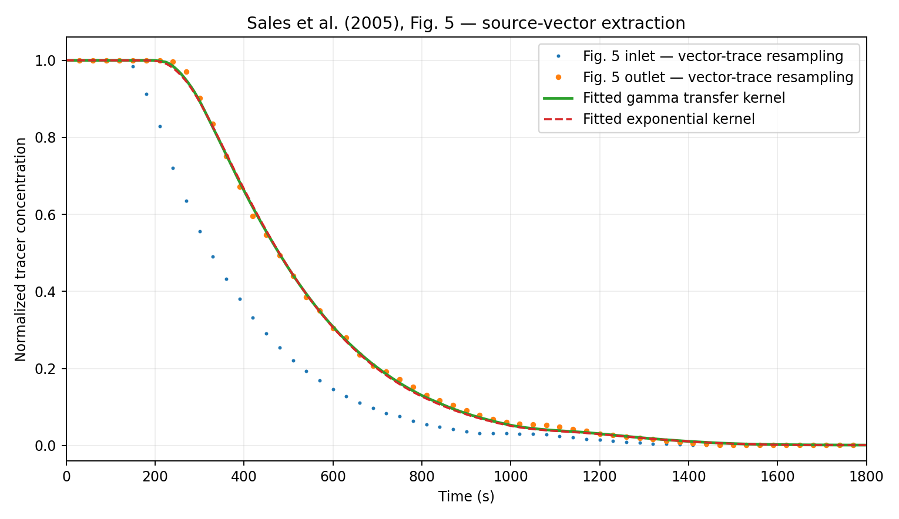
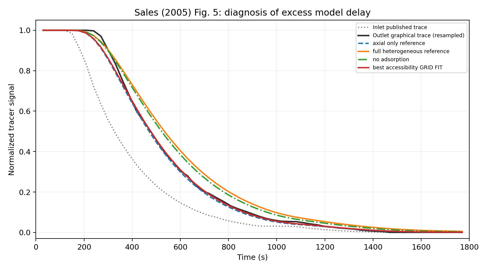
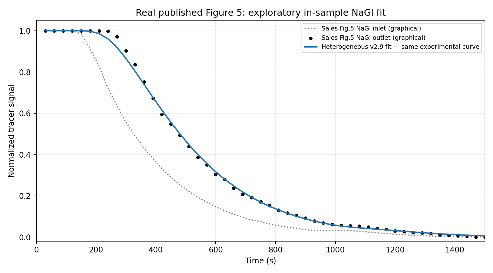
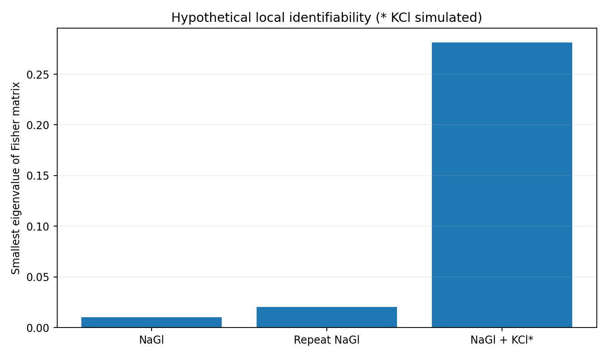

# TrickleBed-Dynamics

**From a simplified three-phase reactor model to experimental-figure RTD analysis, parameter identifiability, and experimental design.**

[](https://github.com/sanatat/TrickleBed-Dynamics/actions/workflows/python-tests.yml)

**Version 2.9 · Python · numerical modelling · gas–liquid–solid reactors**

> **Research status:** This is an independent, exploratory numerical research project. It is **not** a validated industrial CFD model and it does **not** reproduce the full results of Gorshkova et al. (2012). The sodium-gluconate time series come from **vector-digitized figures in a published experiment**, not original instrument files. Every KCl response in this repository is **hypothetical/synthetic**, not measured. The distinction matters throughout this README.

## Why I started this project

A trickle-bed reactor looks straightforward from the outside: gas and liquid flow down through a fixed bed of catalyst particles. Inside, however, the reactor is a complicated network of processes. The liquid does not wet every particle equally. Reactants must cross phase boundaries and diffuse into pores before reacting. Heat is generated and redistributed, and changing a flow rate can alter more than just the residence time.

I started by reading *Three-Phase CFD-Model for Trickle Bed Reactors* by Gorshkova, Manninen, Alopaeus, Laavi and Koskinen (2012). Their work brings hydrodynamics, catalyst wetting, intraparticle transport, reaction and heat transfer together in a CFD framework for octene hydrogenation over Ni/Al₂O₃. I wanted to understand which parts of that physics could be explored with a much smaller, reproducible Python model—and, importantly, how I would know whether a result was trustworthy.

The project changed direction as the evidence improved. I first built a transient, reduced-order reaction model. I then added conservation checks, tracer residence-time analysis, parameter estimation and optimal experimental design. Once I obtained the original PDF of Sales et al. (2005), I could move beyond entirely synthetic tracer curves and investigate the actual *published experimental graphs*. That exposed an interesting problem: a more detailed physical model initially fitted the graph **worse** than a simple model. Much of the later work is an attempt to understand why, rather than hide that discrepancy.

**The central question is:** *What can we genuinely learn about transport and pore accessibility from limited tracer measurements, and what additional experiment would help us separate competing explanations?*

## At a glance: what we did and what we found

| Research component | What was done | Main takeaway | Evidence level |
|---|---|---|---|
| Transient reactor prototype | Coupled simplified external gas, flowing liquid, pore liquid and pore gas with reaction/energy terms | Produces reproducible dynamic scenarios; chemistry and heat-transfer closures remain uncalibrated | Synthetic / numerical |
| Numerical verification | Conservation, stationary-state, positivity, solver-tolerance and grid diagnostics | These check the **implementation**, not physical validity | Code-level verification |
| RTD parameter estimation | Fitted residence-time and exchange parameters; tested different flow conditions | Some parameter combinations yield nearly indistinguishable outputs | Synthetic demonstrations |
| Optimal design | Compared conventional, local D-optimal and robust flow-selection strategies | Informative conditions can improve local parameter sensitivity; selected designs are not experimentally confirmed | Synthetic demonstrations |
| Sales (2005) data preparation | Transcribed Table 3 and digitized Figures 5–6 from the original vector PDF | Established provenance-traceable **published experimental** tracer curves | Secondary experimental evidence |
| RTD curve fitting | Used actual Figure 5 input as a forcing signal and predicted the Figure 5 output | Gamma kernel gave graphical RMSE **0.00704**, but on the same curve used for fitting | In-sample graphical fit |
| Heterogeneous model | Added axial dispersion, liquid–particle exchange, radial diffusion and reversible adsorption | Untuned heterogeneous model initially fitted worse: RMSE **0.04938** | Physical model + graphical comparison |
| Discrepancy study | Varied accessible pore volume, adsorption and dispersion | Lowering assumed pore accessibility reduced mismatch; **not** proof of measured pore access | In-sample sensitivity |
| Dual-tracer identifiability | Compared one tracer, repeated tracer, and a hypothetical second non-adsorbing tracer | In a controlled synthetic example, Fisher condition number fell from **1810** to **108** | Synthetic-only KCl |

We have **128 passing project tests** in the v2.9 packaged test suite. The test count is a software-maintenance result—not a measure of scientific validation.

## 1. Physical problem and reference experiments

### 1.1 The 2012 reactive reactor model that motivated the work

Gorshkova et al. studied exothermic octene hydrogenation:

\[
\mathrm{C_8H_{16} + H_2 \rightarrow C_8H_{18}}
\]

Their Eulerian CFD model treats **gas**, **flowing liquid** and a **fixed solid catalyst** as three phases, while tracking liquid and gas *inside* porous catalyst particles separately. That separation matters because outer wetting, pore filling, diffusion and heat release interact. The paper tests how transport limitations and local heating influence conversion and temperature.

My early Python models borrow the *structure of the problem*, not the authors' Fluent implementation. The simplified model uses axial compartments and time-dependent balances to examine how an imposed flow disturbance changes the model states. It includes an Arrhenius-type temperature dependency and several gas/liquid/pore transfer paths, but important coefficients are illustrative. It is **not** suitable for predicting real industrial hot spots.

### 1.2 The independent experimental RTD source

Sales et al. (2005) measured **nonreactive** tracer responses in a trickle-bed reactor. Their sodium-gluconate solution was removed from the incoming water stream to create a **negative step**; the response is a falling concentration curve, *not* a pulse probability-density curve. This distinction affects how the inlet must be handled mathematically.

The paper reports a reactor approximately **0.80 m high and 0.04 m in diameter**, filled with **918 g activated carbon**, operated at **300 K** and **202.64 kPa**. Figures 5 and 6 concern a gas flow of **300 L/h**, with liquid flows of **5 L/h** and **10 L/h**, respectively. See the article for the full experimental procedure.

| Published material | What is available | How we use it |
|---|---|---|
| Figure 5, 5 L/h | Sodium-gluconate experimental **inlet and outlet** drawn as vector curves | Input–output modelling and model-discrepancy analysis |
| Figure 6, 10 L/h | Experimental **outlet** markers and the authors' plotted fit | Separate visual/numeric comparison; **no paired inlet data** |
| Table 3 | Six **author-optimized** values each for wetting efficiency, liquid holdup and Peclet number at different superficial velocities | Small-sample exploratory trends, **not** original RTD readings |
| KCl measurements | Mentioned in the article's parameter-estimation methodology, without a published time-series in this PDF | **Never presented as experimental KCl data** |

This is why the work now has two related but distinct tracks: a simplified **reactive** numerical demonstrator and a **nonreactive experimental-figure tracer** study. The latter does **not** experimentally validate the former.

## 2. Methodology

### 2.1 Build a transparent transient reactor demonstrator (v0.1–v1.2)

I began with an axial discretization of the bed and evolving concentrations for species in the gas, mobile liquid and catalyst pore compartments. Successive versions introduced a separate pore-gas inventory, changing pore-liquid saturation, geometric interfacial areas, Sherwood-based mass-transfer estimates, approximate reaction kinetics, a heat balance and flow perturbations. They also introduced case-study values from the 2012 paper, such as the 400 K inlet, 20 bar operating pressure and the reported gas/liquid feeds.

A representative mobile-liquid mass balance follows the familiar advection–dispersion–transfer–reaction structure:

\[
\varepsilon_L\frac{\partial C_i}{\partial t}
= -u_L\frac{\partial C_i}{\partial z}
+ D_{\mathrm{ax}}\frac{\partial^2 C_i}{\partial z^2}
+ \sum_j \mathcal{T}_{j\to L,i} + \nu_i r.
\]

Here \(\mathcal{T}\) represents inter-compartment transport and \(\nu_i r\) is a reaction source or sink. **This equation is a schematic balance, not a verbatim transcription of the full implemented solver**; each historical version has its own specific simplifications documented in code and reports. The time integration is based on SciPy ODE solvers, particularly **BDF** for stiff cases.

I checked equivalent species inventories under reaction, overall input/output budgets, temperature-equation consistency, solver-tolerance sensitivity, and limited spatial-grid refinement. The final result of this phase was a tested numerical framework—but the approximately **400–404 K** temperatures in illustrative runs remained far below the approximately **500 K** reported in a 2012 test case. I kept that discrepancy visible rather than force-fitting unknown kinetic constants.

**Important:** A small conservation residual means the discretized equations were coded consistently. It does not establish correct kinetic parameters, wetting laws, phase equilibrium, heat transfer or industrial safety predictions.

### 2.2 Separate the RTD question from the reaction question (v1.3–v1.8)

To examine the hydrodynamic side with fewer uncertain chemistry parameters, I implemented a **nonreactive tracer** path. Early experiments compared a tanks-in-series/Gamma residence-time kernel with a spatial tracer model and examined the exchange between flowing liquid and pore liquid. Later versions used multiple hypothetical flow conditions to fit transfer and dispersion parameters and test parameter recovery.

For a linear, time-invariant tracer model with a measured step-like inlet, the outlet can be written as a convolution:

\[
C_{\mathrm{out}}(t)
= \int_0^t E(\tau) C_{\mathrm{in}}(t-\tau)\,d\tau,
\]

with the appropriate initial-baseline handling. \(E(\tau)\) is the residence-time response kernel, which must remain nonnegative and normalized for a conservative nonreactive system. **We model the observed negative-step signal; we do not treat the falling concentration directly as an RTD probability density.**

For parameter estimation, I minimized residuals between output predictions and reference curves using `scipy.optimize.least_squares`. I also examined local sensitivities and fitted a separate flow condition without re-fitting in several *synthetic* exercises. Those experiments helped expose parameter correlation, but because training and testing signals were generated by the same model family, they are **not independent experimental validation**.

I then tested flow selection using the Fisher information matrix:

\[
\mathcal{I}(\theta) = J(\theta)^\mathsf{T}\Sigma^{-1}J(\theta),
\qquad J_{ij}=\frac{\partial y_i}{\partial\theta_j}.
\]

A local D-optimal design maximizes the log determinant of \(\mathcal{I}\). In the robust variant, I maximize its **worst value over a specified small parameter scenario set**. This is a numerical design study, not a recommendation to run those flow rates on real equipment.

### 2.3 Move from synthetic inputs to a published experiment (v1.9–v2.6)

The first literature-based analysis transcribed **six author-fitted hydrodynamic records** from Sales Table 3. A leave-one-out exercise compared how superficial liquid velocity alone versus liquid and gas velocities predict wetting, liquid holdup and Peclet number. With only six rows, these results are deliberately exploratory.

The more important development came when I obtained the **original 10-page PDF**. Earlier hand-read graph points were replaced by a reproducible **vector-geometry extraction** workflow:

1. Read the original document using **PyMuPDF**, rather than OCR or approximate screenshots.
2. Locate the drawn Figure 5 and Figure 6 regions and identify embedded vector markers/paths.
3. Calibrate the horizontal axis against the printed **0–1800 s** marks and the vertical axis against the normalized **0–1** levels.
4. Reconstruct the Figure 5 entrance and exit curves, retaining **59 resampled rows per series**. These are correlated samples along drawn traces, **not 59 independent lab observations**.
5. Extract **61 printed experimental triangle-marker centers** from Figure 6, separately from the authors' published model polyline.
6. Export CSVs, coordinate calibration, source-PDF SHA-256, method notes and graphical-position uncertainty assumptions in [`PROVENANCE.json`](results/v26_vector_extraction/PROVENANCE.json).

The original PDF is **not redistributed**. The exported data are secondary, figure-derived reconstructions. Figure-position uncertainties are not equivalent to instrumental measurement uncertainty.

Using Figure 5's **plotted experimental inlet**, I compared a fitted Gamma response, a fitted exponential response and a no-residence baseline. The Gamma model fit best in this within-figure comparison. Figure 6 gives us a second **observed outlet** curve, but not the measured inlet forcing at that flow; choosing an unmeasured forcing from its observed output would make a claimed predictive validation circular.



*Sales (2005), Figure 5, 5 L/h. Figure-derived measurements versus a fitted numerical transfer kernel. The fit uses this same curve.*

### 2.4 Build the more physical heterogeneous tracer model (v2.7)

A low graphical error from a flexible Gamma curve does not mean that the physical processes are understood. I therefore implemented a **one-dimensional finite-volume tracer model** motivated by **Sales et al. (2005), Eqs. (7)–(9)**. It includes:

- **Axial convection and dispersion** in the flowing liquid, with a negative-step inlet and zero-gradient outlet treatment.
- **Wetted interfacial exchange** between mobile liquid and porous particles.
- **Radial diffusion inside idealized spherical catalyst particles**, discretized into concentric shells.
- **Reversible linear adsorption**, represented by an assumed first-order relaxation toward equilibrium.

The radial liquid concentrations and adsorbed inventory are separate states. For example, the adsorption relaxation used in this implementation is

\[
\frac{dq}{dt} = k_{\mathrm{ads}}\big(K_{\mathrm{ads}}C_{\mathrm{pore}}-q\big).
\]

**The kinetic relaxation constant was assumed**; this is a numerical approximation, not the complete published Laplace transfer function in Sales Eqs. (13)–(15). Some transport properties come from the article, while others—especially effective void fraction, adsorption kinetics and pore accessibility—require calibration or better experimental evidence. The paper's Table 2 and surrounding text also give conflicting effective-diffusivity scales, which are explicitly flagged rather than silently reconciled.

I used conservative upwind advection and matched interfacial flux terms with opposite signs. This enabled an internal tracer-inventory audit: after accounting for inlet and outlet flux, the discrete model's global conservation residual was approximately **2.78 × 10⁻¹⁷ m/s** in the tested assembly. A uniform equilibrated tracer state is also stationary to numerical precision. These are strong implementation checks, **not experimental verification of the physical model**.

### 2.5 Investigate why the physical model disagrees (v2.8)

The first heterogeneous run fitted the published Figure 5 *worse* than axial dispersion alone. Rather than discard that result, I carried out an **ablation and parameter-trade-off study**:

- Disable adsorption while keeping other terms fixed.
- Vary the assumed fraction of effectively accessible, wetted pore volume.
- Vary axial dispersion independently and in a small two-parameter grid.
- Compare graphical RMSE and response-time characteristics using the **same** published Figure 5 curves.

Reducing the assumed active pore volume substantially reduced excessive tracer retention. But because pore accessibility and axial dispersion can compensate for one another, **this did not uniquely identify pore accessibility in the actual catalyst**. The 10% value reported below is a *model assumption selected on the fitted curve*, not a laboratory measurement.



### 2.6 Ask which additional measurement would actually help (v2.9)

Sales et al. mention an auxiliary **KCl tracer** as part of their parameter-initialization procedure. Their published PDF does **not** provide a time series for KCl. That gave me a narrower, answerable numerical question: *if a second tracer responded differently to adsorption, would the model distinguish pore accessibility from adsorption more clearly?*

I kept **two experiments separate**:

**A. Published-figure NaGl fit.** Fit two uncertain parameters—effective accessible pore fraction and sodium-gluconate adsorption equilibrium coefficient—to the vector-digitized **Figure 5** curve. Other model constants remained at the explicitly documented v2.8 choices. This is **in-sample calibration**, and its fitted pore-access fraction is not a physical measurement.

**B. Controlled synthetic two-tracer experiment.** Generate both NaGl and a **hypothetical non-adsorbing KCl** response from the same numerical forward model. Assign assumed KCl pore diffusivity of **1.3 × 10⁻⁹ m²/s** and zero adsorption. Add reproducible Gaussian synthetic noise. Fit the two log-parameters using NaGl alone or NaGl plus synthetic KCl, then compare parameter recovery and local Fisher information. I also compare with simply repeating the NaGl measurement.

The Fisher comparison uses **19 selected time points per tracer** and assumed normalized-signal noise standard deviation **0.015**. Sensitivities are computed by central finite differences of the two **log-transformed parameters**, so the condition number depends on parameter scaling and these assumptions. A limited **3 × 3** nominal-parameter grid tests whether the information gain persists over nine hypothetical cases.

Because **the same model generates and fits the synthetic observations**, this is an *inverse-crime demonstration*. It shows why a second tracer *could* help; it cannot prove that real KCl data will produce the same improvement.



*Left track: in-sample model fit to published graph-derived sodium-gluconate observations.*



*Right track: model-generated, hypothetical dual-tracer sensitivity; no real KCl observations are used.*

## 3. Results, including the results that did not work

### 3.1 RTD extraction and descriptive results

| Quantity | Reported result | Interpretation |
|---|---:|---|
| Figure 5 resampling | 59 points per plotted entrance/exit series | **Graph-resampled, correlated**, not 59 independent experiments |
| Figure 6 experimental markers | 61 | Printed vector triangle centers; **outlet only** |
| Figure 5 inlet half-concentration time | 325.7 s | Descriptive reading of the published plotted trace |
| Figure 5 outlet half-concentration time | 476.7 s | Roughly **151 s later** than inlet |
| Figure 5 Gamma kernel | RMSE **0.00704** | In-sample graphical-fit diagnostic |
| Figure 5 exponential kernel | RMSE **0.00853** | In-sample graphical-fit diagnostic |
| Figure 5 no-residence baseline | RMSE **0.13617** | Model used for comparison |
| Figure 6 authors' published model curve | RMSE **0.02763** against printed markers | **Authors' fit**, not our model's validation |

These RMSE values concern **normalized plotted-signal units** and should not be interpreted as instrument-level accuracy. Our Figure 5 RTD fitting and Figure 6 authors' curve comparison are different calculations.

### 3.2 Heterogeneous model and discrepancy analysis

| Figure 5 model/scenario | Graphical RMSE | How the number was obtained |
|---|---:|---|
| Axial dispersion only | **0.01487** | Fixed parameter choices |
| Full heterogeneous model before calibration | **0.04938** | Literature-informed **plus assumed** properties |
| Heterogeneous model with adsorption disabled | **0.03898** | Process ablation |
| Effective pore accessibility set to 25% | **0.01343** | Assumption sensitivity |
| Effective pore accessibility set to 10% | **0.01233** | Assumption sensitivity |
| Coarse joint accessibility/dispersion scan | **0.00949** | Lowest tested **in-sample** combination |
| Phenomenological Gamma curve | **0.00704** | More flexible, **three-parameter** in-sample fit |

The lesson here is not that the catalyst has 10% pore accessibility. It is that **effective storage and transport parameters are confounded**: changing one uncertain closure can improve a curve without demonstrating which physical process caused the mismatch. The parameter counts and calibration procedures also differ, so the RMSEs are *diagnostics*, not a controlled model-ranking contest.

### 3.3 Real sodium gluconate fit in v2.9

| Parameter | Exploratory fitted value |
|---|---:|
| Accessible pore fraction | **0.1891** |
| NaGl adsorption equilibrium coefficient | **5.864 × 10⁻⁶ m³/kg** |
| Full-figure graphical RMSE | **0.01192** |
| Fitted transition-region RMSE | **0.01468** |

These values result from fitting the **same plotted experiment**. They have not been confirmed by independent wetting, adsorption or pore-diffusion measurements; the adsorption coefficient is sensitive to other model assumptions.

### 3.4 What the hypothetical second tracer changes

| Local Fisher diagnostic | Synthetic NaGl only | Repeat synthetic NaGl | NaGl + **hypothetical** KCl |
|---|---:|---:|---:|
| Smallest eigenvalue | 0.0101 | 0.0202 | **0.281** |
| Condition number | 1,810 | 1,810 | **108** |
| Correlation between two fitted log-parameters | −0.992 | −0.992 | **−0.762** |

Within this particular local simulation, a second tracer with different assumed adsorption behavior provides more *independent parameter information* than simply repeating the same tracer. Across nine assumed parameter cases, the gain in minimum Fisher eigenvalue ranged from about **25× to 44×**. **None of these are real KCl measurements or experimentally established uncertainty intervals.**

In one seeded synthetic recovery trial, the log-parameter error norm fell from **4.407** (single tracer) to **0.295** (two tracers). One realization cannot establish statistical robustness; the result is only a proof of method in a favorable simulator.

## 4. What I consider the main achievements

**First, the data trail is auditable.** We went from rough hand-read points to an extraction procedure tied to the original PDF, plotted vector coordinates, calibrated axes and recorded source hash. Someone with the source paper can reconstruct the figure-derived CSVs and challenge the assumptions.

**Second, failures are part of the results.** The physically more detailed model originally fitted poorly. That result led to a specific hypothesis about effective pore storage and, more importantly, a warning that different model parameters can explain the same tracer curve.

**Third, numerical checks are independent from experimental claims.** The code includes tests for conservation, limits, grid/tolerance sensitivity and consistent assembly. They establish the behaviour of our implemented equations—not agreement with reality.

**Fourth, the analysis now suggests a useful next experiment.** A paired, independently measured sodium-gluconate/KCl experiment, with both inlet and outlet responses, could reveal whether the extra observable actually separates adsorption from pore accessibility. This is a more constructive outcome than continuing to tune one curve indefinitely.

These are **methodological and computational achievements**, not evidence of a validated new reactor process or an independently confirmed physical mechanism.

## 5. Limitations and questions still open

- **No validated reactive CFD:** the Python model is a reduced-order demonstrator. It does not reproduce the three-phase CFD pressure/velocity closure, full vapor–liquid equilibrium, latent heat, catalyst wetting relations or complete reaction kinetics of Gorshkova et al. (2012).
- **Tracer physics versus reaction physics:** the validated provenance belongs to **nonreactive** sodium-gluconate RTD figures from a different reactor and catalyst; it does **not** establish Ni/Al₂O₃ reaction performance or industrial hot-spot risk.
- **No raw tracer recordings:** the figure-derived curves inherit uncertainty from plotting, line thickness, extraction and unknown original instrument errors. Resampling creates strongly correlated observations.
- **Missing Figure 6 inlet:** we cannot claim an independent 10 L/h inlet–outlet transfer prediction without the time-dependent inlet or a confirmed injection protocol.
- **Missing KCl measurements:** the KCl model is a designed synthetic comparison; the article's mention of a second tracer does not supply its time series.
- **Uncertain transport closure:** the published effective diffusivity text and Table 2 do not agree in scale; adsorption kinetics and assumed bed porosity are not separately validated.
- **Non-unique parameter estimates:** pore accessibility, surface exchange, adsorption capacity and dispersion can trade off against each other. Fisher information is *local*, depends on parameter scaling and a chosen measurement-noise model.
- **Limited design robustness:** D-optimal and robust-flow studies use synthetic assumptions and ignore industrial feasibility/safety constraints.
- **No original source PDF redistributed:** the reader must obtain Sales (2005) independently.

For detailed per-version limitations see [`docs/SCIENTIFIC_SCOPE.md`](docs/SCIENTIFIC_SCOPE.md), [`docs/DATA_PROVENANCE.md`](docs/DATA_PROVENANCE.md), and the reports under `results/`.

## 6. Reproduce the results

### Requirements

Python **3.11+** with `numpy`, `scipy`, `matplotlib`, `PyMuPDF` and `pytest`. CPU-only operation; no CUDA/GPU is required for these scripts. On Linux Mint or another Unix-like environment:

```bash
python3 -m venv .venv
source .venv/bin/activate
python -m pip install --upgrade pip
python -m pip install -r requirements.txt
```

### Run the current analysis

```bash
python dual_tracer_v29.py
python -m pytest -q
```

The first command writes the current report, comparison curves and Fisher diagnostics to `results/v29_dual_tracer/`. The second runs the test suite. **Tests are offline by default**; an original PDF is needed only for the optional source-extraction test.

### Reconstruct published-figure CSVs from your own article PDF

```bash
python vector_digitize_v26.py --pdf /path/to/Sales2005.pdf --out results/v26_vector_extraction
python fit_vector_rtd_v26.py
SALES2005_PDF=/path/to/Sales2005.pdf python -m pytest -q
```

The source paper is available from [Sales et al. (2005)](https://doi.org/10.1590/S0104-66322005000300012). The original PDF must be supplied locally; the repository intentionally contains **only** reconstructed figure data, not the PDF itself.

### Re-run selected research stages

```bash
python run_v6.py                  # reduced-order reactive transport demonstration
python verification_v12.py       # numerical checks
python rtd_experiment_v13.py     # synthetic RTD fitting
python identifiability_v16.py    # synthetic multi-flow parameter estimation
python optimal_design_v17.py    # local D-optimal flow selection
python robust_design_v18.py     # robust in-silico flow selection
python sales2005_experimental_v19.py  # published Table 3 analysis
python heterogeneous_rtd_v27.py # physical Figure 5 RTD comparison
python v28_diagnosis.py          # discrepancy and pore-accessibility sensitivity
python dual_tracer_v29.py        # real NaGl fit + separate synthetic KCl study
```

The historical scripts are retained as research iterations; results do not all belong to one monolithic calibrated solver. Running a newer analysis may overwrite the corresponding saved output folder. Recorded published-figure CSVs and per-run reports explain what was used for each analysis.

## 7. Where to look in the repository

| Path | Contents |
|---|---|
| `model.py`, `three_phase.py`, `v*_model.py` | Earlier transient transport and reactive numerical prototypes |
| `verification_v12.py`, `quality_audit_v11.py` | Internal consistency and numerical verification |
| `rtd_calibration.py`, `rtd_experiment_v13.py` | Phenomenological and synthetic RTD modelling |
| `identifiability_v16.py`, `optimal_design_v17.py`, `robust_design_v18.py` | Parameter estimation and experimental design studies |
| `vector_digitize_v26.py`, `fit_vector_rtd_v26.py` | Publication-vector extraction and phenomenological Figure 5 comparison |
| `heterogeneous_rtd_v27.py`, `v28_diagnosis.py`, `dual_tracer_v29.py` | Physical tracer model, mismatch diagnosis and hypothetical dual-tracer test |
| `results/v26_vector_extraction/` | Reconstructed figure CSVs, original-PDF geometry/calibration audit and plots |
| `results/v27_heterogeneous_rtd/`, `results/v28_root_cause/` | Mechanistic comparisons, model ablations and their limits |
| `results/v29_dual_tracer/` | Current NaGl graphical fit; distinctly labeled synthetic KCl/Fisher results |
| `docs/DEVELOPMENT_HISTORY.md` | Stage-by-stage development notes |
| `docs/DATA_PROVENANCE.md` | Traceability and data reuse cautions |
| `KCL_DATA_REQUEST.md` | **Unsent** draft requesting original experimental measurements |
| `tests/`, `.github/workflows/python-tests.yml` | Local tests and GitHub Actions test job |

## 8. What I would do next

The most useful next result would be a **paired, independently recorded two-tracer dataset**, including sodium gluconate and KCl inlet/outlet histories at the same operating conditions, along with adsorption tests, measurement uncertainty and repeated runs. I would use one condition for model development and at least one *separate* condition for assessment. In parallel, it would be worth implementing and cross-checking Sales' reported analytical transfer function so the finite-volume approximations are tested against the paper's own equations rather than only against its printed curves.

Only after that would I connect experimentally constrained hydrodynamics to higher-fidelity chemistry and thermal models and make claims about predictive performance under industrial flow changes.

## References

1. **Sales, F. G.; Maranhão, L. C. A.; Pereira, J. A. F. R.; Abreu, C. A. M. (2005).** *Experimental Dynamic Evaluation of Three-Phase Reactors.* Brazilian Journal of Chemical Engineering **22**(3), 443–452. [DOI: 10.1590/S0104-66322005000300012](https://doi.org/10.1590/S0104-66322005000300012).
2. **Gorshkova, E.; Manninen, M.; Alopaeus, V.; Laavi, H.; Koskinen, J. (2012).** *Three-Phase CFD-Model for Trickle Bed Reactors.* International Journal of Nonlinear Sciences and Numerical Simulation **13**, 397–404. [DOI: 10.1515/ijnsns-2012-0015](https://doi.org/10.1515/ijnsns-2012-0015).
3. See the above papers for the underlying references on trickle-bed wetting, heterogeneous tracer response, kinetic transport and multiphase hydrodynamics. This repository attributes the original experimental observations and does not claim them as independently collected data.

## Attribution, citation and reuse

This is an **independent research exercise**, not an official project of Aalto University, Neste, or the authors of either paper. I have not collected the published laboratory measurements myself. The figures are redrawn or reconstructed solely for transparent comparison with the cited work.

For citation metadata, see [`CITATION.cff`](CITATION.cff). **No software license is currently granted in this repository**; appearing on GitHub does not automatically make code freely reusable. A license can be added later by the repository owner. Please cite the original papers when referring to their experimental data or physical modelling contributions.
